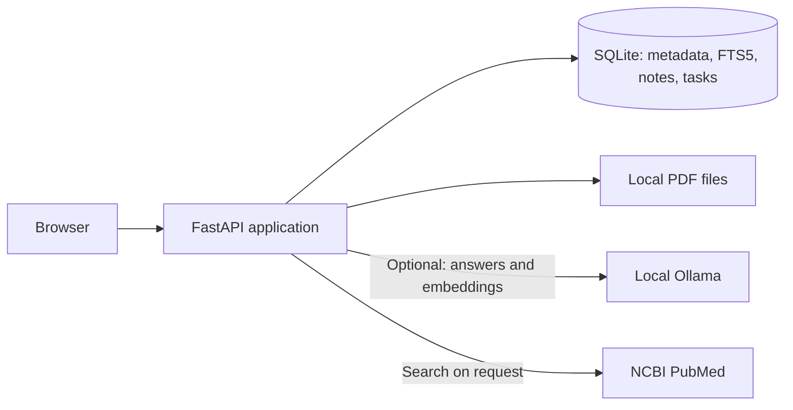

# VIRA Bio

**Find checkable evidence in biomedical PDFs.** VIRA Bio is a local-first research workspace that imports PDFs, retrieves relevant passages, and links every result to its source page. An optional local Ollama model can draft an answer from retrieved excerpts; the source pages remain the place to verify it.

This repository is the current VIRA Bio application. The earlier voice-assistant prototype remains available in the Git history.

## What you can do

- **Build a PDF library:** Import multiple text-based PDFs that you have permission to store and process. VIRA keeps the files and search index in a local SQLite-backed workspace.
- **Find source passages:** Search the full text with SQLite FTS5 and open a result at its original PDF page.
- **Ask your PDFs:** Get relevant excerpts with page citations. With Ollama enabled, VIRA can draft a short answer and checks its source references, exact quotes, and numbers before displaying it. These checks cannot prove the interpretation is correct.
- **Add semantic retrieval:** Optionally create local embeddings with Ollama and combine semantic and keyword rankings. Keyword search works without an embedding model.
- **Discover papers on PubMed:** Search citation metadata and links on demand. VIRA does not automatically download or import article full text.
- **Organize research:** Keep notes and tasks in the same workspace.

The interface opens on **Instructions** and focuses on **PDF Library**. There is no general-purpose chat page.

## How it works



The default `extractive` provider returns matching PDF excerpts without generating a conclusion. The optional `ollama` provider receives retrieved excerpts on the same computer. PubMed receives only search terms when a user requests a lookup. See [Architecture](docs/ARCHITECTURE.md) for the retrieval and citation flow.

## Run locally

Requires Python 3.12 or newer. No paid API key is required.

```bash
git clone https://github.com/HoDucManhNguyen/VIRA-Bio.git
cd VIRA-Bio
python3 -m venv .venv
source .venv/bin/activate
python -m pip install -r requirements.txt
cp .env.example .env
python run.py
```

Open <http://127.0.0.1:8000>. On an existing installation, keep its `.env` and `data/` folder; do not replace them with files from a new clone. Follow the [setup guide](SETUP.md) for PDF import, Ollama, semantic search, and troubleshooting.

To enable locally generated answers, install [Ollama](https://ollama.com/download), run `ollama pull gemma3:4b`, and set these values in `.env` before restarting VIRA:

```dotenv
VIRA_PROVIDER=ollama
VIRA_MODEL=gemma3:4b
VIRA_OLLAMA_URL=http://127.0.0.1:11434
```

For hybrid retrieval, also run `ollama pull nomic-embed-text` and build the index from **PDF Library → Semantic search**. Ollama is optional for keyword retrieval and source-linked excerpts.

## Share a small workspace

The [sharing guide](SHARING.md) explains how to expose a temporary HTTPS link from your own computer. Visitors use a browser and share one PDF library, notes, and tasks. Anonymous sharing gives every visitor access to read, add, and delete shared data, so use only non-confidential material. The server and Ollama remain bound to localhost.

There is no permanent public demo URL yet. A portfolio demo should use a PDF that can be published and should explain that free hosting may reset uploaded files and the SQLite database.

## Verify and evaluate

```bash
python -m pip install -r requirements-dev.txt
python -m unittest discover -s tests -v
```

Tests cover PDF import, retrieval, citation behavior, API access controls, and PubMed parsing. The [benchmark guide](benchmarks/README.md) describes how to label source pages and compare keyword with hybrid retrieval. No biomedical accuracy score is claimed until a human-labeled document set has been evaluated.

## Current scope

| Capability | Status |
| --- | --- |
| PDF import, FTS5 search, source-page links | Implemented |
| Source-backed PDF questions | Implemented; local Ollama optional |
| Local hybrid retrieval | Implemented; embedding model optional |
| PubMed citation metadata lookup | Implemented |
| Automated entailment verification and validated biomedical benchmark | Planned |
| DOI/PMID/license-aware article import | Planned |
| Reproducible biostatistics analysis workspace | Planned |

VIRA Bio is for research and learning, not clinical diagnosis or treatment. PDF text extraction requires selectable text; scanned documents need OCR first. Individual PDFs are limited to 25 MB and 500 pages. Always inspect the cited page before relying on a claim.

**Data:** By default, VIRA stores its SQLite database at `data/vira.db` and imported PDFs in `data/library/`. Both `.env` and `data/` are excluded from Git. Back up the database and PDF directory together. Never publish patient records, private PDFs, passwords, or API credentials.
